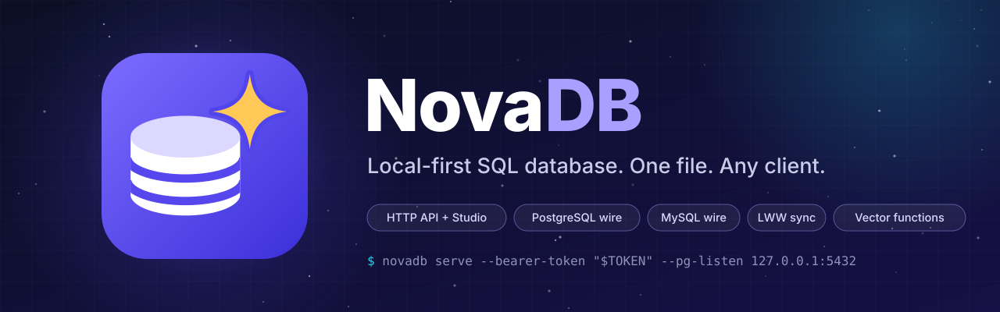
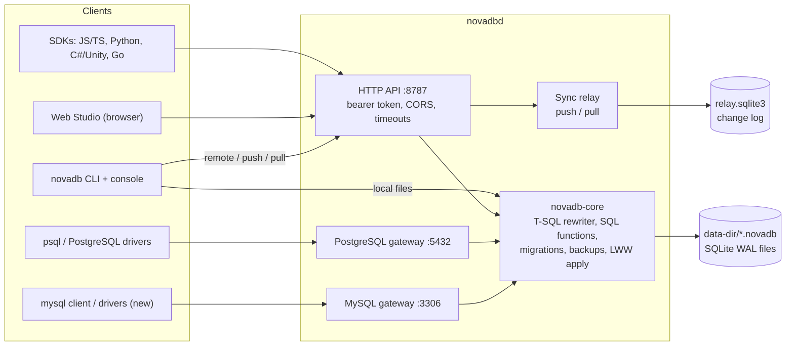

<p align="center">
  
</p>

<p align="center">
  <a href="https://github.com/hoangtuvungcao/NovaDB/releases"></a>
  <a href="https://github.com/hoangtuvungcao/NovaDB/actions/workflows/ci.yml"></a>
  <a href="https://hoangtuvungcao.github.io/NovaDB/"></a>
  <a href="LICENSE"></a>
  
</p>

<p align="center">
  <a href="https://hoangtuvungcao.github.io/NovaDB/"><b>Documentation</b></a> ·
  <a href="https://hoangtuvungcao.github.io/NovaDB/getting-started/quickstart">Quickstart</a> ·
  <a href="https://hoangtuvungcao.github.io/NovaDB/migration/">Migration guides</a> ·
  <a href="https://hoangtuvungcao.github.io/NovaDB/faq">Limitations</a> ·
  <a href="CONTRIBUTING.md">Contributing</a>
</p>

**NovaDB** is a local-first SQL database written in Rust on top of SQLite. Each database is a single file; the
`novadbd` server makes many of them available over an **HTTP JSON API with a built-in Web Studio**, a
**PostgreSQL wire gateway** and a new **MySQL wire gateway**, so websites, backends and games can use the same
data from any language. Tables can be **synced between devices** with deterministic last-writer-wins replication,
and SQL is extended with **UUID v7, JSON, crypto, date and vector functions** plus a **T-SQL compatibility layer**
that eases moving small SQL Server workloads. It is a young project: one writer per database, no clustering, and
SQLite semantics underneath. See [Limitations](#limitations).

## Highlights

- **One file per database.** SQLite in WAL mode: concurrent readers, ACID writes, online backups, integrity checks.
- **Many ways in.** HTTP API (port 8787), Web Studio (`/studio`), PostgreSQL wire protocol (5432), MySQL wire
  protocol (3306, new), the `novadb` CLI with an interactive console, and an embeddable Rust crate.
- **Web Studio.** Table editor with inline editing, structure view, create-table builder, multi-tab SQL editor
  with highlighting, import/export, maintenance panel, dark and light themes.
- **Local-first sync.** Per-table change capture with hybrid logical clocks, idempotent push/pull through the
  relay, whole-row LWW conflict resolution.
- **Official SDKs** for JavaScript/TypeScript, Python, C#/.NET/Unity and Go: zero dependencies, parameter
  binding, query builder, migrations, typed errors.
- **Secure by default.** Loopback listeners by default; refuses to expose HTTP or PostgreSQL publicly without
  credentials; SCRAM-SHA-256; CORS allow-list; request timeouts and connection caps.
- **Migration helpers.** Rewrites common T-SQL (`TOP`, `OFFSET/FETCH`, `IDENTITY`, `N'...'`, `PIVOT`, `GO`) and
  documents, with tested matrices, what still needs manual changes.

## 5-minute quickstart

**1. Install** (Linux/macOS; Windows: `irm https://raw.githubusercontent.com/hoangtuvungcao/NovaDB/master/scripts/install.ps1 | iex`)

```bash
curl -fsSL https://raw.githubusercontent.com/hoangtuvungcao/NovaDB/master/scripts/install.sh | bash
```

**2. Serve with credentials**

```bash
export NOVADB_BEARER_TOKEN="$(openssl rand -hex 32)" NOVADB_PG_USER=novadb NOVADB_PG_PASSWORD="$(openssl rand -hex 16)"
novadb serve --listen 127.0.0.1:8787 --pg-listen 127.0.0.1:5432 --data-dir ./novadb-data
```

**3. Create a database**

```bash
curl -X POST http://127.0.0.1:8787/v1/admin/databases/app -H "Authorization: Bearer $NOVADB_BEARER_TOKEN"
curl -X POST http://127.0.0.1:8787/v1/databases/app/sql/execute \
  -H "Authorization: Bearer $NOVADB_BEARER_TOKEN" -H "Content-Type: application/json" \
  -d '{"sql": "CREATE TABLE todos(id INTEGER PRIMARY KEY, title TEXT NOT NULL, done INT NOT NULL DEFAULT 0)"}'
```

**4. Connect**

- **Studio:** open <http://127.0.0.1:8787/studio> and paste the token.
- **psql:** `PGPASSWORD="$NOVADB_PG_PASSWORD" psql -h 127.0.0.1 -U novadb -d app -c "SELECT * FROM todos"`
- **MySQL client (new):** see the [MySQL wire guide](https://hoangtuvungcao.github.io/NovaDB/connect/mysql).
- **SDK:** see the use cases below.

Full walkthrough: [Quickstart](https://hoangtuvungcao.github.io/NovaDB/getting-started/quickstart).

## Use cases

### Website (JavaScript / TypeScript)

```ts
import { NovaDB } from "@novadb/client";   // build from sdks/javascript (not on npm yet)

const db = new NovaDB({ url: "http://127.0.0.1:8787", token, database: "app" });
await db.table("todos").insert({ title: "Ship the landing page" });
const open = await db.table("todos").where({ done: 0 }).orderBy("id").limit(20).get();
await db.table("todos").update({ done: 1 }).where({ id: 1 });
```

Start the server with `--cors-origin https://your.site` for browser calls, and keep the token server-side in
production. Example: [`examples/web-todo`](examples/web-todo).

### Backend (Python)

```python
from novadb import NovaDB   # pip install -e sdks/python  (the PyPI package "novadb" is unrelated)

with NovaDB("http://127.0.0.1:8787", token=token, database="app") as db:
    db.migrate([{"version": 1, "name": "notes", "sql": "CREATE TABLE notes(id INTEGER PRIMARY KEY, title TEXT)"}])
    db.execute("INSERT INTO notes(title) VALUES (?)", ["Hello"])
    latest = db.table("notes").order_by("id", "desc").limit(10).get()
```

Example: [`examples/backend-python`](examples/backend-python), a stdlib JSON API that keeps the token private.

### Game (C# / Unity)

```csharp
var db = new NovaDBClient(new NovaDBOptions { Url = "https://api.your-game.example", Token = token, Database = "game" });
await db.ExecuteAsync(
    "INSERT INTO scores(player_id, best_score) VALUES (?, ?) " +
    "ON CONFLICT(player_id) DO UPDATE SET best_score = excluded.best_score WHERE excluded.best_score > scores.best_score",
    new object[] { playerId, score });
var top = await db.QueryAsync("SELECT player_id, best_score FROM scores ORDER BY best_score DESC LIMIT 10");
```

Runs on .NET Standard 2.1 / Unity 2021.2+ (WebGL via a `UnityWebRequest` transport). Never ship the admin token
in a game build; route writes through your game server. Example:
[`examples/game-leaderboard`](examples/game-leaderboard). Sizing and sharding advice for many clients:
[Game and multi-user servers](https://hoangtuvungcao.github.io/NovaDB/guides/game-servers).

## Official SDKs

Zero-dependency HTTP clients for the REST API on port 8787:

| Language | Directory | Quick taste |
|---|---|---|
| JavaScript / TypeScript (browser, Node 18+, Deno, Bun) | [`sdks/javascript`](sdks/javascript) | `await new NovaDB({ url, token, database: "app" }).query("SELECT * FROM users WHERE id = ?", [1])` |
| Python 3.8+ | [`sdks/python`](sdks/python) | `NovaDB(url, token, "app").table("users").where(id=1).first()` |
| C# / .NET / Unity | [`sdks/csharp`](sdks/csharp) | `await db.Table("scores").OrderByDescending("score").Limit(10).GetAsync()` |
| Go | [`sdks/go`](sdks/go) | `db.Query(ctx, "SELECT * FROM users WHERE team = :t", novadb.Named{"t": "red"})` |

Every SDK provides bearer-token authentication, a configurable base URL and timeout, typed errors, client-side
parameter binding (`?` and `:name`), a small query builder, and migrations, backups and sync push/pull. The
packages are not yet published to npm/PyPI/NuGet; install them from this repository. Details:
[sdks/README.md](sdks/README.md) and the [SDK docs](https://hoangtuvungcao.github.io/NovaDB/sdks/).

## Architecture



## Documentation

The documentation website is **<https://hoangtuvungcao.github.io/NovaDB/>** (source in [`website/`](website)):

- [Getting started](https://hoangtuvungcao.github.io/NovaDB/getting-started/installation): installation and quickstart
- [Guides](https://hoangtuvungcao.github.io/NovaDB/guides/cli-console): CLI and console, Web Studio, sync, vector search, RBAC, backups
- [Connect](https://hoangtuvungcao.github.io/NovaDB/connect/http-api): HTTP API, PostgreSQL wire, MySQL wire
- [Migration guides](https://hoangtuvungcao.github.io/NovaDB/migration/): from SQLite, MySQL, SQL Server, PostgreSQL
- [Deployment](https://hoangtuvungcao.github.io/NovaDB/deployment/binary-systemd): systemd, Docker, [Kubernetes](deploy/kubernetes), security hardening
- [Reference](https://hoangtuvungcao.github.io/NovaDB/reference/sql-dialect): SQL dialect, functions, CLI, configuration, HTTP API ([OpenAPI](docs/openapi.yaml))

Legacy Markdown docs remain in [`docs/`](docs/README.md).

## Limitations

NovaDB is **experimental (v0.1.x)**. Know these before you depend on it:

- **Single node, single writer.** SQLite allows one writer per database at a time (writers inside one server queue; busy timeout 10 s by default). Roughly 20-25k autocommit statements/s through the PG/MySQL gateways and 25-50k/s over HTTP per database file on a dev laptop; shard into several databases for more. See [Game and multi-user servers](https://hoangtuvungcao.github.io/NovaDB/guides/game-servers). There is **no clustering,
  replication for high availability, or failover**; LWW sync is for local-first replicas, not server HA.
- **Not a drop-in replacement** for MySQL, PostgreSQL or SQL Server. The wire gateways speak their protocols and
  pass a mini-app suite with SQLAlchemy, Knex, Sequelize, Prisma (MySQL), PDO, Go and psycopg (see
  [ORM and driver compatibility](https://hoangtuvungcao.github.io/NovaDB/connect/orm-compatibility)), but SQL runs on
  SQLite with its type system (no exact decimals, no native dates, no length checks); PostgreSQL arrays and many
  extensions are unsupported, and `psql` is untested.
- **No stored procedures.** T-SQL `CREATE PROCEDURE`/`CREATE FUNCTION` are accepted and discarded, and `EXEC proc`
  is an explicit no-op. Batches with `DECLARE`, `IF`, `WHILE`, `TRY/CATCH`, `THROW`/`RAISERROR`, cursors,
  `EXEC (...)`/`sp_executesql` and `BEGIN TRAN ... ROLLBACK` do run in a built-in interpreter (not in the interactive
  console or read-only queries); a transaction cannot span calls.
- **Unsupported features fail loudly.** Temporal tables, XML methods, row-level security, T-SQL triggers,
  users/roles/`GRANT`/`EXECUTE AS`, data masking, encryption keys, Service Broker, `TOP ... WITH TIES/PERCENT`,
  `GROUP BY ROLLUP/CUBE/GROUPING SETS`, `AT TIME ZONE`, spatial methods, `*_AI` collations and complex `APPLY` forms
  return an `unsupported SQL` error. `CHECKSUM` is not SQL Server's algorithm and `HASHBYTES` hashes text as UTF-8.
  See [From SQL Server](https://hoangtuvungcao.github.io/NovaDB/migration/from-sql-server).
- **Rewriter pitfalls:** `ROWVERSION` becomes a random blob; integer division by zero returns `NULL` instead of
  raising error 8134; `XACT_STATE()` and `SERVERPROPERTY()` are fixed values. See
  [known pitfalls](https://hoangtuvungcao.github.io/NovaDB/migration/#known-pitfalls).
- **Security model:** one bearer token (HTTP) and one user/password (PostgreSQL), each with full access. No
  per-user permissions on the servers yet, no built-in TLS, no encryption at rest.
- **Default limits** (all configurable, see [Configuration](https://hoangtuvungcao.github.io/NovaDB/reference/configuration)): SQL text 16 MiB per request, HTTP body 64 MiB, 10000 HTTP connections, 1000 PG/MySQL sessions (about 0.4-0.5 MiB each), `/sql/query` results capped at 1,000,000 rows / 512 MiB (`413`, paginate).
- **Vector search** is an exact scan without an ANN index.
- **Packaging:** no published container image or registry packages yet.

Full list: [FAQ and limitations](https://hoangtuvungcao.github.io/NovaDB/faq).

## Benchmarks

Measured on one laptop (Intel i5-13420H, 12 threads, NVMe, Linux), release builds, localhost, no TLS, with the load
generator on the same CPU. Each cell is the **median of 3 runs**; the full tables with min-max spreads, methodology and
caveats are in [`benches/results/LATEST.md`](benches/results/LATEST.md) and [`benches/README.md`](benches/README.md).
Reproduce with `benches/run.sh`.

| Workload (100,000-row table) | NovaDB embedded | NovaDB PG wire | NovaDB MySQL wire | NovaDB HTTP | rusqlite | MySQL 8.0.46 |
|---|---:|---:|---:|---:|---:|---:|
| Point select by PK, p50 (us) | 10 | 116 | 165 | 248 | 2.9 | 52 |
| Insert, autocommit (rows/s) | 47,488 | 3,439 | 4,469 | 2,646 | 65,687 | 331 (default) / 19,624 (relaxed) |
| Insert, 1000 per transaction (rows/s) | 105,094 | 8,051 | 7,422 | 66,018 | 261,358 | 14,355 / 26,308 |
| Point selects, 16 clients (ops/s) | 55,757 | 40,015 | 38,677 | 17,148 | 1,411,216 | 69,006 |
| Mixed 90/10 read/write, 16 clients (ops/s) | 36,149 | 11,294 | 19,765 | 8,834 | 152,348 | 36,142 / 50,540 |
| Failed writes in the mixed run | n/a | 0 | 0 | 0 | n/a | 0 |

How to read this honestly:

- NovaDB is SQLite underneath, so it will not beat plain SQLite. Its guards (authorizer, change capture, JSON result
  building) cost roughly 3x per call compared with raw `rusqlite`, and one shared handle serialises work behind one
  connection (use `NovaDbPool` for parallel reads). Scans and aggregates match SQLite.
- Over the network, the PostgreSQL, MySQL and HTTP paths cost 100-250 us per statement in this setup, and the Python
  clients add tens of microseconds of their own, so compare the network columns with each other and with MySQL, not
  with the in-process columns.
- NovaDB runs WAL with `synchronous=NORMAL`, while MySQL's default fsyncs every commit, which is why MySQL is shown
  with both default and relaxed (`innodb_flush_log_at_trx_commit=2`) durability. MySQL is faster at point selects and
  many concurrent clients on this machine.
- One machine, one run configuration, a loaded laptop: treat the numbers as indicative and measure your own
  workload. No claims are made about PostgreSQL, because no PostgreSQL server was installed to compare against.

### Multi-user (128 clients)

Load generator (Rust, one TCP connection per client, closed loop) on the same laptop and CPU as the server, loopback.
Interleaved 5-round A/B, median ops/s and median p99 latency; "old" is commit 02a589c, "new" is the current tree
(HTTP read pool, group commit, background checkpoints). Dataset: 100,000-row table, autocommit writes.

| Protocol / workload | Old ops/s | New ops/s | Old p99 (ms) | New p99 (ms) |
|---|---:|---:|---:|---:|
| HTTP 90/10 read/write | 12.9k | 37.3k | 157 | 9.9 |
| HTTP write-only | 3.8k | 19.2k | 423 | 17.3 |
| PostgreSQL 90/10 | 22.1k | 27.5k | 173 | 23.7 |
| PostgreSQL write-only | 4.6k | 14.1k | 193 | 30.7 |
| MySQL 90/10 | 22.9k | 28.1k | 75 | 24.6 |
| MySQL write-only | 5.6k | 19.8k | 176 | 24.7 |

Indicative only: single laptop, loadgen and server compete for CPU, and individual rounds varied a lot (PG write-only
new: 3.7k to 21.2k). Eight fresh runs on a quieter machine gave PG write-only 18-28k and MySQL write-only 29-47k ops/s
with 0 errors. SQLite allows one writer per database file, so the ceiling is roughly 20-25k autocommit statements/s via
the gateways and 25-50k/s over HTTP per database; shard for more. Details:
[`benches/results/LATEST-multiuser.md`](benches/results/LATEST-multiuser.md).

## Contributing

Contributions are welcome. Read [CONTRIBUTING.md](CONTRIBUTING.md) (setup, tests, Conventional Commits,
trunk-based workflow, releases) and the [Code of Conduct](CODE_OF_CONDUCT.md). Report security issues privately as
described in [SECURITY.md](SECURITY.md).

## License

NovaDB, including the SDKs in `sdks/`, is licensed under the [Apache-2.0 License](LICENSE).
